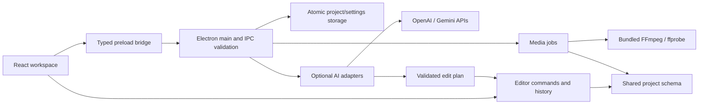

# Architecture

Banana Editor is a local desktop application. There is no application backend,
cloud database, account requirement or payment layer. The release target is
Windows x64; core and service code avoid unnecessary platform assumptions.

## Boundaries

| Area | Responsibility |
| --- | --- |
| `src/shared/model.ts` | Strict Zod schemas and serializable project types |
| `src/core/` | Time conversion, project validation, atomic commands, undo/redo, evaluation and captions |
| `src/main/index.ts` | OS integration, registered-file access, dialogs, IPC sender/payload checks and job ownership |
| `src/main/persistence.ts` | Atomic project writes and project-relative media references |
| `src/main/media/` | Probe, cache, thumbnails, waveforms, proxies, composition, export and bounded evidence extraction |
| `src/main/ai/` | Provider capabilities, SDK calls, normalized errors, scoped proposal validation |
| `src/preload/` | Named typed operations only; no generic file or shell API |
| `src/renderer/` | Panels, controls, selection, interaction and central playback element |

The core imports neither React nor Electron. UI, shortcuts and AI proposals all
reach the same command functions. `executeCommands` clones and validates before
returning a new revision; a failed transaction leaves the original project intact.
`History` stores transactions, including multi-step AI plans, for one-step undo.
Undo/redo advance revision numbers so stale plans cannot become current by chance.

## Time and composition

Timeline starts/durations are safe integer frames. FPS is `{num, den}`. Source
in-points are seconds in source media; sample positions use the sequence sample
rate. Ranges are start-inclusive/end-exclusive. 30000/1001 is retained as a ratio,
not rounded to 29.97 before calculating edits. See [project format](project-format.md).

The core evaluates clip effects/keyframes with clamped endpoints and linear or
hold interpolation. FFmpeg expressions follow those same semantics. Layer order,
track visibility, mute/solo, black gaps, audio silence, transforms, fades and
explicit cross dissolves feed one composition path. Text is rendered with the
bundled font into raster layers reused by preview and export.

The program monitor plays a generated full-timeline composition cache. A single
HTML media element supplies its audio/video clock and seeks. This gives render
parity at the cost of rebuilding the cache after edits; no realtime GPU compositor
is claimed. Timeline clips are drawn for the visible horizontal region.

## Media jobs

MediaService owns a bounded FIFO queue. Native child processes receive separate
arguments with `shell: false`, limited protocol access, cancellation and bounded
diagnostics. Probing checks actual streams instead of assuming support from an
extension. Thumbnails, audio peaks and browser-compatible proxies are derivatives
in application cache; source files are never modified.

Export writes a unique temporary output next to the destination, reads actual
FFmpeg progress, probes the result, and only then commits the final file.
Source media overwrite is forbidden. Cancellation/failure removes temporary
outputs. CPU codecs provide the baseline independently of detected GPU APIs.

## Files and recovery

The renderer cannot ask for arbitrary file reads. Main registers imported/project
assets and serves media through an opaque custom-protocol identifier. Project
input is validated before use. Manual save writes atomically; recovery saves use
a different file so they do not replace a good manual save. Missing media is
reported for explicit relinking rather than silently substituted.

## AI

AI is opt-in and main-process-only. Credentials use OS encryption or session
memory. Selected evidence is bounded and reviewed before submission. Neither
provider receives arbitrary tools. Plan application validates schema, selected
scope, project/sequence identity, revision, locks, time bounds and replay state.
The user reviews and applies the plan as one editor transaction.

See [AI providers](ai-providers.md), [privacy](privacy.md), and the
[decision records](decisions/0001-local-desktop-and-native-media.md).
